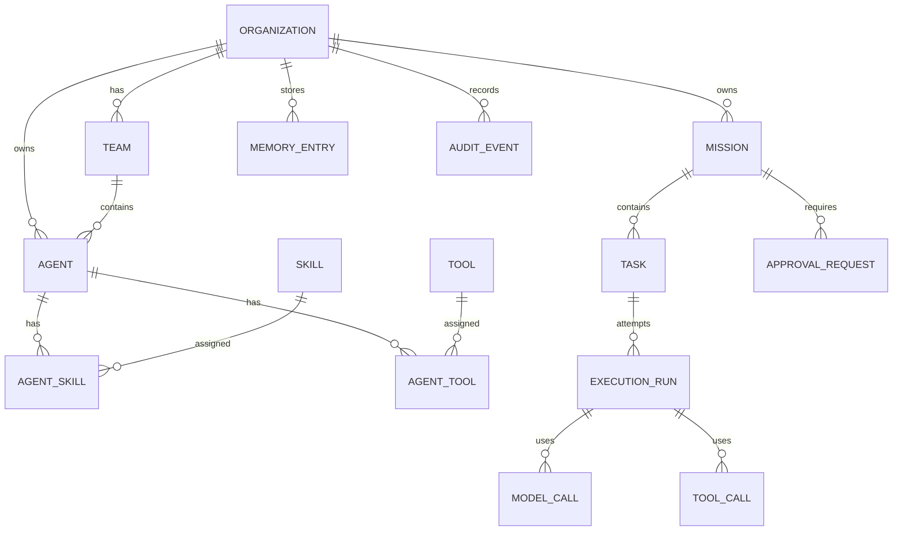

# AgentOS Database ERD v0.1

## 1. Database Choice

Use PostgreSQL as the primary database.

Recommended extensions later:

- pgvector for embedding search
- uuid-ossp or gen_random_uuid support

For v0.1, standard relational tables plus JSONB are enough.

## 2. ERD Overview

## 3. Core Tables

### organizations

| Column | Type | Notes |
|---|---|---|
| id | uuid | PK |
| name | varchar(255) | Not null |
| slug | varchar(255) | Unique |
| description | text | Nullable |
| status | varchar(50) | ACTIVE, SUSPENDED, ARCHIVED |
| created_at | timestamptz | Not null |
| updated_at | timestamptz | Not null |

### teams

| Column | Type | Notes |
|---|---|---|
| id | uuid | PK |
| organization_id | uuid | FK organizations |
| name | varchar(255) | Not null |
| purpose | text | Nullable |
| status | varchar(50) | ACTIVE, ARCHIVED |
| created_at | timestamptz | Not null |
| updated_at | timestamptz | Not null |

### agents

| Column | Type | Notes |
|---|---|---|
| id | uuid | PK |
| organization_id | uuid | FK organizations |
| team_id | uuid | FK teams, nullable |
| reports_to_agent_id | uuid | FK agents, nullable |
| name | varchar(255) | Not null |
| role | varchar(255) | Not null |
| level | varchar(50) | JUNIOR, MID, SENIOR, LEAD, MANAGER |
| status | varchar(50) | DRAFT, ACTIVE, DEGRADED, SUSPENDED, ARCHIVED |
| autonomy_level | varchar(50) | OBSERVE, SUGGEST, EXECUTE, CONDITIONAL, MANAGED |
| created_at | timestamptz | Not null |
| updated_at | timestamptz | Not null |

### agent_contracts

| Column | Type | Notes |
|---|---|---|
| id | uuid | PK |
| agent_id | uuid | FK agents |
| version | integer | Not null |
| mission | text | Not null |
| responsibilities | jsonb | Not null |
| constraints | jsonb | Not null |
| escalation_rules | jsonb | Not null |
| output_format | jsonb | Nullable |
| active | boolean | Not null |
| created_at | timestamptz | Not null |

Constraint:

- Unique active contract per agent.

### skills

| Column | Type | Notes |
|---|---|---|
| id | uuid | PK |
| organization_id | uuid | FK organizations, nullable for global |
| name | varchar(255) | Not null |
| version | varchar(50) | Not null |
| description | text | Nullable |
| instructions | text | Not null |
| required_tools | jsonb | Nullable |
| optional_tools | jsonb | Nullable |
| status | varchar(50) | DRAFT, ACTIVE, DEPRECATED, ARCHIVED |
| created_at | timestamptz | Not null |
| updated_at | timestamptz | Not null |

### agent_skills

| Column | Type | Notes |
|---|---|---|
| id | uuid | PK |
| agent_id | uuid | FK agents |
| skill_id | uuid | FK skills |
| enabled | boolean | Not null |
| assigned_at | timestamptz | Not null |

### tools

| Column | Type | Notes |
|---|---|---|
| id | uuid | PK |
| organization_id | uuid | FK organizations |
| name | varchar(255) | Not null |
| type | varchar(50) | API, MCP, CLI, DATABASE, FILESYSTEM, BROWSER |
| config | jsonb | Non-secret config |
| status | varchar(50) | ACTIVE, DISABLED, ARCHIVED |
| created_at | timestamptz | Not null |
| updated_at | timestamptz | Not null |

### agent_tools

| Column | Type | Notes |
|---|---|---|
| id | uuid | PK |
| agent_id | uuid | FK agents |
| tool_id | uuid | FK tools |
| enabled | boolean | Not null |
| assigned_at | timestamptz | Not null |

### tool_permissions

| Column | Type | Notes |
|---|---|---|
| id | uuid | PK |
| agent_tool_id | uuid | FK agent_tools |
| capability | varchar(255) | Example: repository.read |
| decision | varchar(50) | ALLOW, APPROVAL_REQUIRED, DENY |
| conditions | jsonb | Optional |

### model_providers

| Column | Type | Notes |
|---|---|---|
| id | uuid | PK |
| organization_id | uuid | FK organizations |
| provider | varchar(50) | OPENAI, ANTHROPIC, GEMINI, LOCAL |
| display_name | varchar(255) | Not null |
| status | varchar(50) | ACTIVE, DISABLED |
| rate_limit_config | jsonb | Nullable |
| created_at | timestamptz | Not null |

### agent_model_configs

| Column | Type | Notes |
|---|---|---|
| id | uuid | PK |
| agent_id | uuid | FK agents |
| primary_provider_id | uuid | FK model_providers |
| primary_model | varchar(255) | Not null |
| fallback_provider_id | uuid | FK model_providers, nullable |
| fallback_model | varchar(255) | Nullable |
| strategy | varchar(50) | FIXED, SMART, CHEAPEST, FASTEST, QUALITY |
| max_input_tokens | integer | Nullable |
| max_output_tokens | integer | Nullable |

### missions

| Column | Type | Notes |
|---|---|---|
| id | uuid | PK |
| organization_id | uuid | FK organizations |
| team_id | uuid | FK teams |
| created_by_user_id | uuid | Human user id |
| manager_agent_id | uuid | FK agents |
| title | varchar(255) | Not null |
| goal | text | Not null |
| status | varchar(50) | Mission state |
| priority | varchar(50) | LOW, NORMAL, HIGH, URGENT |
| budget_limit | numeric(12,4) | Nullable |
| created_at | timestamptz | Not null |
| updated_at | timestamptz | Not null |

### tasks

| Column | Type | Notes |
|---|---|---|
| id | uuid | PK |
| mission_id | uuid | FK missions |
| title | varchar(255) | Not null |
| description | text | Not null |
| status | varchar(50) | Task state |
| task_type | varchar(50) | ANALYSIS, DESIGN, IMPLEMENTATION, REVIEW, QA, TOOL_ACTION |
| priority | varchar(50) | LOW, NORMAL, HIGH, URGENT |
| depends_on | jsonb | Array of task ids |
| created_by_agent_id | uuid | FK agents, nullable |
| assigned_agent_id | uuid | FK agents, nullable |
| created_at | timestamptz | Not null |
| updated_at | timestamptz | Not null |

### execution_runs

| Column | Type | Notes |
|---|---|---|
| id | uuid | PK |
| task_id | uuid | FK tasks |
| agent_id | uuid | FK agents |
| status | varchar(50) | CREATED, RUNNING, WAITING_APPROVAL, FAILED, COMPLETED, REJECTED |
| attempt_number | integer | Not null |
| started_at | timestamptz | Nullable |
| completed_at | timestamptz | Nullable |
| input_summary | text | Nullable |
| output_summary | text | Nullable |
| error_message | text | Nullable |

### model_calls

| Column | Type | Notes |
|---|---|---|
| id | uuid | PK |
| execution_run_id | uuid | FK execution_runs |
| agent_id | uuid | FK agents |
| provider | varchar(50) | Provider name |
| model | varchar(255) | Model name |
| request_id | varchar(255) | Provider request id |
| status | varchar(50) | STARTED, COMPLETED, FAILED |
| input_tokens | integer | Nullable |
| output_tokens | integer | Nullable |
| cost | numeric(12,6) | Nullable |
| latency_ms | integer | Nullable |
| error_message | text | Nullable |
| created_at | timestamptz | Not null |

### tool_calls

| Column | Type | Notes |
|---|---|---|
| id | uuid | PK |
| execution_run_id | uuid | FK execution_runs |
| agent_id | uuid | FK agents |
| tool_id | uuid | FK tools |
| capability | varchar(255) | Capability requested |
| status | varchar(50) | REQUESTED, APPROVED, EXECUTED, DENIED, FAILED |
| input | jsonb | Request payload |
| output | jsonb | Result payload |
| error_message | text | Nullable |
| created_at | timestamptz | Not null |
| completed_at | timestamptz | Nullable |

### approval_requests

| Column | Type | Notes |
|---|---|---|
| id | uuid | PK |
| organization_id | uuid | FK organizations |
| mission_id | uuid | FK missions, nullable |
| task_id | uuid | FK tasks, nullable |
| execution_run_id | uuid | FK execution_runs, nullable |
| requested_by_agent_id | uuid | FK agents |
| action_type | varchar(255) | Not null |
| risk_level | varchar(50) | LOW, MEDIUM, HIGH, CRITICAL |
| impact_summary | text | Not null |
| request_payload | jsonb | Action details |
| status | varchar(50) | PENDING, APPROVED, REJECTED, EXPIRED, CANCELLED |
| approved_by_user_id | uuid | Nullable |
| decision_reason | text | Nullable |
| created_at | timestamptz | Not null |
| decided_at | timestamptz | Nullable |

### memory_entries

| Column | Type | Notes |
|---|---|---|
| id | uuid | PK |
| organization_id | uuid | FK organizations |
| scope | varchar(50) | AGENT, TEAM, MISSION, TASK, ORGANIZATION |
| owner_agent_id | uuid | FK agents, nullable |
| team_id | uuid | FK teams, nullable |
| mission_id | uuid | FK missions, nullable |
| task_id | uuid | FK tasks, nullable |
| content | text | Not null |
| source_type | varchar(50) | USER, AGENT, TOOL, ARTIFACT, FILE |
| source_ref | varchar(500) | Nullable |
| confidence | numeric(4,3) | Nullable |
| visibility | varchar(50) | PRIVATE, TEAM, ORGANIZATION |
| expires_at | timestamptz | Nullable |
| created_at | timestamptz | Not null |

### artifacts

| Column | Type | Notes |
|---|---|---|
| id | uuid | PK |
| mission_id | uuid | FK missions |
| task_id | uuid | FK tasks, nullable |
| execution_run_id | uuid | FK execution_runs, nullable |
| name | varchar(255) | Not null |
| artifact_type | varchar(50) | MARKDOWN, CODE, JSON, FILE, LINK |
| content | text | Nullable |
| uri | varchar(1000) | Nullable |
| created_by_agent_id | uuid | FK agents, nullable |
| created_at | timestamptz | Not null |

### audit_events

| Column | Type | Notes |
|---|---|---|
| id | uuid | PK |
| organization_id | uuid | FK organizations |
| mission_id | uuid | FK missions, nullable |
| task_id | uuid | FK tasks, nullable |
| actor_type | varchar(50) | HUMAN, AGENT, SYSTEM |
| actor_id | uuid | Nullable |
| event_type | varchar(255) | Not null |
| payload | jsonb | Not null |
| created_at | timestamptz | Not null |

## 4. Indexing Recommendations

| Table | Index |
|---|---|
| teams | organization_id |
| agents | organization_id, team_id, status |
| missions | organization_id, team_id, status |
| tasks | mission_id, status, assigned_agent_id |
| execution_runs | task_id, agent_id, status |
| model_calls | execution_run_id, agent_id, created_at |
| tool_calls | execution_run_id, agent_id, status |
| approval_requests | organization_id, status |
| memory_entries | organization_id, scope, owner_agent_id, team_id, mission_id |
| audit_events | organization_id, mission_id, created_at |

## 5. Migration Strategy

Use Flyway.

Initial migrations:

| Migration | Purpose |
|---|---|
| V001 | Organization, team, agent |
| V002 | Skill, tool, permissions |
| V003 | Model provider and model config |
| V004 | Mission, task, execution run |
| V005 | Model call, tool call |
| V006 | Approval request, policy |
| V007 | Memory, artifact, audit event |

## Delivered V010 approval metadata subset

The target `approval_requests` definition above describes the future complete workflow. V010 currently delivers only a metadata ledger: id, organization_id, team_id, optional mission_id/task_id/requested_by_agent_id, title, action_type, risk_level, status, created_at and updated_at. Status also supports NEEDS_INFORMATION and INVALIDATED from the approved UI flow. Same-scope composite references bind Team/Mission/Task; no payload, execution run, human decision fields, grants or enforcement is delivered. See [migration scope](backend/APPROVAL_METADATA_MIGRATION.md).
