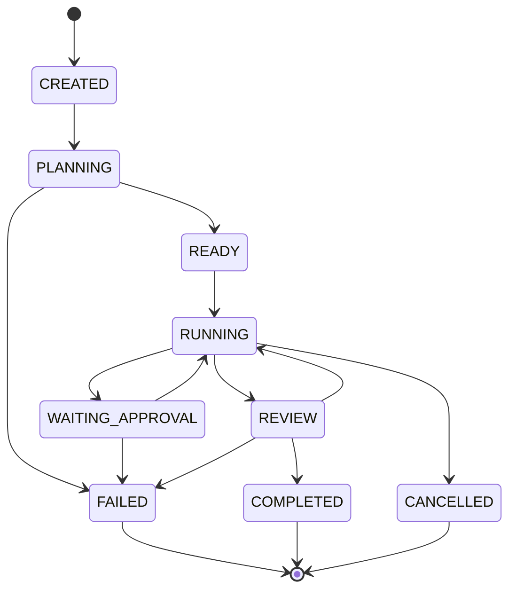
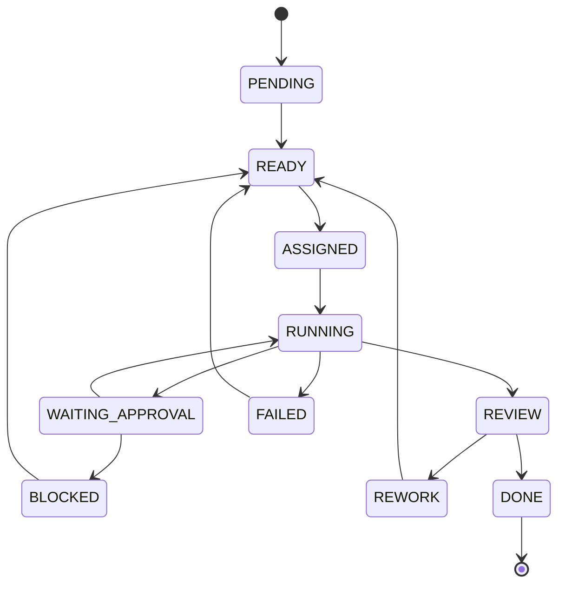
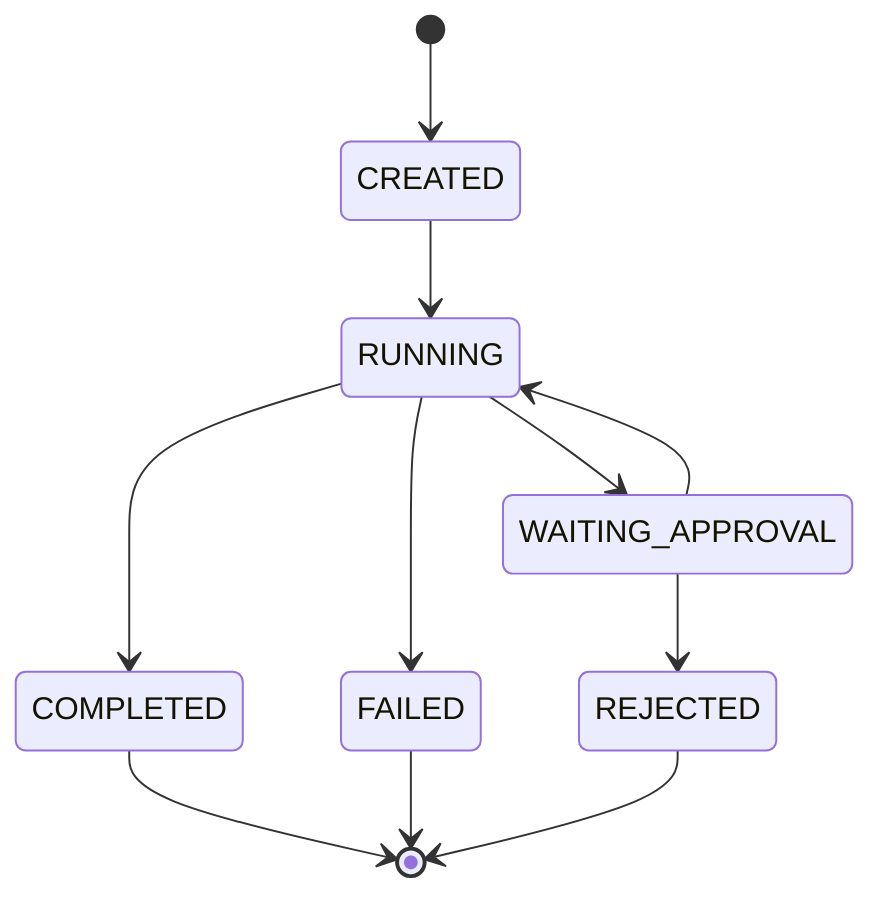
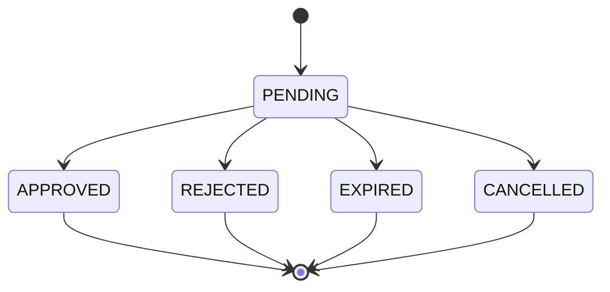

# AgentOS Mission and Task State Machines v0.1

Historical conceptual design. The persisted Task vocabulary differs from this document; do not implement its state names or migrate data by inference. See the [current proposed runtime lifecycle/authority contract](docs/engineering/RUNTIME_LIFECYCLE_AUTHORITY_CONTRACT.md) for compatibility rules and review status. No runtime transitions are implemented by these documents.

## 1. Design Principle

State machines must be deterministic.

LLMs may propose actions, plans, and outputs, but the platform controls state transitions.

This prevents agents from self-declaring success or bypassing governance.

## 2. Mission State Machine



## 3. Mission States

| State | Meaning |
|---|---|
| CREATED | Mission was created by human but not planned |
| PLANNING | Manager Agent is producing task graph |
| READY | Task graph exists and mission can start |
| RUNNING | One or more tasks are active |
| WAITING_APPROVAL | Mission is paused by approval requirement |
| REVIEW | Result is being validated |
| COMPLETED | Mission finished successfully |
| FAILED | Mission failed |
| CANCELLED | Human cancelled mission |

## 4. Mission Transitions

| From | To | Trigger |
|---|---|---|
| CREATED | PLANNING | Orchestrator starts planning |
| PLANNING | READY | Task graph created |
| PLANNING | FAILED | Planning failed after retry limit |
| READY | RUNNING | First task starts |
| RUNNING | WAITING_APPROVAL | A required action needs approval |
| WAITING_APPROVAL | RUNNING | Human approves |
| WAITING_APPROVAL | FAILED | Human rejects and no replanning path exists |
| RUNNING | REVIEW | All tasks completed |
| REVIEW | RUNNING | Reviewer requests rework |
| REVIEW | COMPLETED | Reviewer accepts result |
| REVIEW | FAILED | Review fails after retry limit |
| RUNNING | CANCELLED | Human cancels |

## 5. Task State Machine



## 6. Task States

| State | Meaning |
|---|---|
| PENDING | Task exists but dependencies are not complete |
| READY | Task can be assigned |
| ASSIGNED | Task has an assigned agent |
| RUNNING | Agent is executing task |
| WAITING_APPROVAL | Task is paused by approval requirement |
| BLOCKED | Task cannot proceed without external decision |
| REVIEW | Output is waiting for review |
| REWORK | Reviewer requested changes |
| DONE | Task completed |
| FAILED | Task failed |

## 7. Task Transitions

| From | To | Trigger |
|---|---|---|
| PENDING | READY | Dependencies complete |
| READY | ASSIGNED | Orchestrator assigns agent |
| ASSIGNED | RUNNING | Execution run starts |
| RUNNING | WAITING_APPROVAL | Tool/policy requires approval |
| WAITING_APPROVAL | RUNNING | Human approves |
| WAITING_APPROVAL | BLOCKED | Human rejects and task cannot proceed |
| RUNNING | REVIEW | Agent submits output |
| REVIEW | DONE | Reviewer accepts |
| REVIEW | REWORK | Reviewer rejects |
| REWORK | READY | Rework task is scheduled |
| RUNNING | FAILED | Execution error or retry limit reached |
| FAILED | READY | Retry allowed |
| BLOCKED | READY | Blocker resolved |

## 8. Execution Run State Machine



## 9. Execution Run Rules

- Every task attempt creates one execution run.
- Retrying a task creates a new execution run.
- Execution run stores model calls, tool calls, and output summary.
- A completed execution run does not automatically mean task is done.
- Review must decide whether task output is accepted.

## 10. Approval Flow



## 11. Approval Rules

Approval request must include:

- Requested action
- Agent requesting action
- Mission/task context
- Risk level
- Impact summary
- Exact payload to execute
- Policy rule that triggered approval

Human decision must include:

- Decision
- Optional reason
- Decision timestamp
- Approver identity

## 12. Retry and Loop Limits

MVP defaults:

| Limit | Default |
|---|---:|
| Max task retries | 3 |
| Max planning retries | 2 |
| Max reviewer rejections | 3 |
| Max agent discussion rounds | 5 |
| Max delegation depth | 4 |
| Max mission duration | Configurable |
| Max mission cost | Configurable |

When a limit is reached:

```text
ESCALATE_TO_MANAGER
  -> ESCALATE_TO_HUMAN if manager cannot resolve
```

## 13. Events Emitted by State Changes

| Transition | Event |
|---|---|
| Mission created | MISSION_CREATED |
| Planning starts | MISSION_PLANNING_STARTED |
| Planning completes | MISSION_PLANNED |
| Task created | TASK_CREATED |
| Task assigned | TASK_ASSIGNED |
| Execution starts | EXECUTION_STARTED |
| Approval requested | APPROVAL_REQUESTED |
| Approval granted | APPROVAL_GRANTED |
| Approval rejected | APPROVAL_REJECTED |
| Task submitted for review | TASK_REVIEW_REQUESTED |
| Task rejected | TASK_REJECTED |
| Task completed | TASK_COMPLETED |
| Mission completed | MISSION_COMPLETED |
| Mission failed | MISSION_FAILED |
